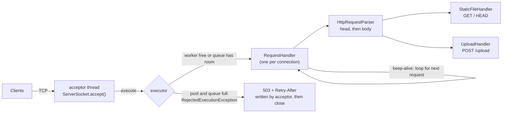

# HTTP/1.1 Server From Scratch

A multi-threaded HTTP/1.1 server written in plain Java 21 on top of `java.net.ServerSocket`.
No frameworks and no dependencies: the request parser, connection handling, thread pool
setup and the test runner are all in this repository.

It serves static files, accepts JSON uploads, supports keep-alive and pipelining, and is
hardened against the usual problems of a thread-per-connection server (slow clients,
oversized requests, unbounded queues). Every behaviour listed below is covered by the test
suite in `test/`.

## Features

What is implemented, with the RFC section it follows:

- **Request parsing from raw bytes** (RFC 7230 3): request line and headers are read byte by
  byte up to the empty line, decoded as ISO-8859-1. The body is read as bytes, never as chars.
- **Case-insensitive header names** (RFC 7230 3.2): `content-length` and `Content-Length` are the same.
- **Message body framing** (RFC 7230 3.3):
  - `Content-Length` must be a non-negative integer; repeated values must be identical, otherwise 400.
  - `Transfer-Encoding: chunked` request bodies are decoded. Chunk extensions and trailer fields
    are read and ignored.
  - A request with both `Transfer-Encoding` and `Content-Length` is rejected with 400
    (see [Request smuggling](#request-smuggling)).
  - Any transfer coding other than `chunked` gets 501.
- **Methods**: `GET`, `HEAD` (same headers as GET, no body) and `POST /upload`. Other standard
  methods get 405 with an `Allow` header; unknown methods get 501.
- **Versions**: HTTP/1.0 and HTTP/1.1. Any other well-formed version gets 505. Responses are
  always sent as `HTTP/1.1` (RFC 7230 2.6).
- **Host header** (RFC 7230 5.4): an HTTP/1.1 request without `Host`, or with more than one, gets 400.
  The value is not compared with the bind address: behind a proxy or a DNS name the server
  cannot know which name clients use.
- **Request targets**: origin-form (`/path?query`) and absolute-form (`http://host/path`).
  The query string is ignored and the path is percent-decoded (UTF-8, `+` is not a space).
- **Persistent connections** (RFC 7230 6.3): HTTP/1.1 stays open unless the client sends
  `Connection: close`; HTTP/1.0 closes unless the client sends `Connection: keep-alive`.
  Pipelined requests are answered in order.
- **Responses** always carry `Date` (IMF-fixdate), `Server`, `Connection` and a
  `Content-Length` counted in bytes. Files are streamed in 8 KB pieces.
- **Path traversal protection**: the decoded path is normalized and must stay inside the web
  root; the check is repeated after resolving symlinks. `/../x`, `/%2e%2e/x` and `/..%2fx` all get 403.
- **Uploads**: `POST /upload` with `Content-Type: application/json` stores the body as
  `upload_<uuid>.json` in a separate upload directory (not under the web root). Files are created
  with `CREATE_NEW`, so an upload can never overwrite another file. The JSON check is only a
  shape check (valid UTF-8, starts with `{`, ends with `}`), not a full parser.
- **Limits and timeouts** (table below): header size and count, body size, header deadline,
  keep-alive idle timeout and max requests per connection.
- **Two thread models**: a bounded platform thread pool (default) or one virtual thread per
  connection (`--mode=virtual`), mainly for comparing the two in benchmarks.

Status codes the server can send: 200, 201, 400, 403, 404, 405, 408, 413, 414, 415, 431, 500,
501, 503, 505.

### Not implemented

- TLS / HTTPS
- HTTP/2 and HTTP/3
- Chunked or compressed **responses** (every response has a `Content-Length`)
- Trailer semantics: request trailers are read and thrown away
- `Expect: 100-continue`: the server never sends `100 Continue` (curl waits about 1 second, then sends the body anyway)
- Range requests, conditional requests (`ETag`, `If-Modified-Since`), content negotiation
- `OPTIONS` and `TRACE` (they get 405)
- Obsolete header line folding (rejected with 400)
- Directory listings, and `index.html` for subdirectories (only `/` maps to `/index.html`)
- Write timeouts: a client that stops reading a large response can hold a worker until TCP gives up
- A connection cap in virtual mode (see below)

## Architecture



| Class | Job |
|---|---|
| `Server` | Reads config, binds the socket, runs the accept loop, creates the executor, sends 503 when full |
| `ServerConfig` | Defaults, environment variables and `--flags` |
| `RequestHandler` | One connection: timeouts, keep-alive loop, routing, error handling, lingering close |
| `TimedInputStream` | Sets `SO_TIMEOUT` before each network read; supports a total deadline |
| `HttpRequestParser` | Request line, headers, Content-Length / chunked body, all limits |
| `HttpRequest` | Parsed request with a case-insensitive header map |
| `StaticFileHandler` | Percent-decoding, traversal checks, file streaming |
| `UploadHandler` | JSON upload to the upload directory |
| `HttpResponseBuilder` | Status line, standard headers, error pages, 8 KB file streaming |
| `MimeTypeResolver` | Content types and which files are served |

### Life of a connection

1. The acceptor thread accepts the socket and calls `executor.execute(handler)`.
2. The handler waits up to the **idle timeout** (5 s) for the first byte of a request.
   No byte: the connection is closed quietly.
3. From the first byte, the request line and all headers must arrive within the
   **header deadline** (10 s total). Too slow: 408 and close.
4. The body is read with a per-read timeout, as exactly `Content-Length` bytes or as chunks.
5. The request is routed and answered. If the connection should stay open, go back to step 2.
6. Any parse error throws an `HttpException` with the right status. The handler sends the
   error with `Connection: close`, shuts down its sending side, drains the input for up to
   500 ms (so the client is not hit by a TCP reset before it reads the error), then closes.

## Concurrency and backpressure

In platform mode (the default) the executor is:

```java
new ThreadPoolExecutor(threads, threads, 0L, TimeUnit.MILLISECONDS,
        new ArrayBlockingQueue<>(queueCapacity), threadFactory,
        new ThreadPoolExecutor.AbortPolicy());
```

- **Fixed number of workers** (64 by default). Each connection holds a worker for its whole
  life, including keep-alive idle time, so the thread count limits concurrent connections.
- **Bounded queue** (128 by default). `Executors.newFixedThreadPool` uses an unbounded
  `LinkedBlockingQueue`, so under overload connections pile up in memory and wait without limit.
  A bounded queue gives a hard cap on waiting work.
- **AbortPolicy** makes `execute()` throw `RejectedExecutionException` as soon as the pool and
  queue are full. The acceptor catches it and writes a short `503 Service Unavailable` with
  `Retry-After: 1`, then closes. The client gets a fast, clear answer instead of hanging.
  `CallerRunsPolicy` would make the acceptor thread run the connection itself, so it would stop
  accepting while it serves one (possibly slow) client: the slowdown spreads to everyone.
- **Timeouts free workers.** The keep-alive idle timeout (5 s) and the header deadline (10 s)
  bound how long one connection can hold a worker without sending a full request. A
  per-read `SO_TIMEOUT` alone is not enough: a Slowloris client that sends one byte every few
  seconds resets it forever. The deadline in `TimedInputStream` cannot be pushed back.
- **Max 100 requests per connection** so one busy client cannot keep a worker forever.

In virtual mode (`--mode=virtual` or `SERVER_MODE=virtual`) each connection gets its own
virtual thread from `Executors.newVirtualThreadPerTaskExecutor()`. Blocking reads park the
virtual thread instead of a platform thread, so idle keep-alive connections are cheap and there
is no queue and no 503. The trade-off is that nothing limits the number of connections
except the timeouts and OS limits (file descriptors, memory).

## Request smuggling

When a proxy sits in front of a server, both must agree where each request ends. If a request
carries both `Transfer-Encoding: chunked` and `Content-Length`, one side may use the chunked
framing and the other the length. The bytes left over are then read as the start of a *second*
request that the proxy never saw (and never checked). RFC 7230 3.3.3 says `Transfer-Encoding`
wins, but also allows rejecting such messages. This server rejects them with 400 and closes the
connection, because it cannot know what an upstream proxy decided. For the same reason it
rejects conflicting duplicate `Content-Length` values, negative or non-numeric lengths, bare CR
characters in headers, whitespace before the colon in a header name, and folded header lines.

## Limits

| Limit | Default | How to change | When exceeded |
|---|---|---|---|
| Request line + headers | 8 KB | `ServerConfig.maxHeaderBytes` | 431 (414 if the request line alone is too long), close |
| Number of header fields | 100 | `ServerConfig.maxHeaderCount` | 431, close |
| Request body | 10 MB | `--max-body-bytes` | 413, close (body is not read) |
| Header deadline | 10 s total | `--header-timeout-ms` | 408, close |
| Body read timeout | 10 s per read | `ServerConfig.bodyReadTimeoutMs` | 408, close |
| Keep-alive idle timeout | 5 s | `--idle-timeout-ms` | connection closed |
| Requests per connection | 100 | `--max-requests` | last response has `Connection: close` |
| Worker threads (platform mode) | 64 | `--threads`, `THREADS` | connections wait in the queue |
| Queue capacity (platform mode) | 128 | `--queue`, `QUEUE_CAPACITY` | 503 with `Retry-After: 1` |

## Running

Requires JDK 21 or newer.

```bash
javac -d out src/*.java
java -cp out Server                              # http://127.0.0.1:8080
java -cp out Server --port=9000 --threads=16 --queue=32
java -cp out Server --mode=virtual --log-requests
java -cp out Server --help                       # prints all options
```

All options: `--host`, `--port`, `--mode`, `--threads`, `--queue`, `--web-root`, `--upload-dir`,
`--idle-timeout-ms`, `--header-timeout-ms`, `--max-requests`, `--max-body-bytes`, `--log-requests`.
Environment variables `PORT`, `HOST`, `SERVER_MODE`, `THREADS`, `QUEUE_CAPACITY`, `WEB_ROOT`,
`UPLOAD_DIR` and `LOG_REQUESTS` are read first; flags override them. If `PORT` is set the server
binds to `0.0.0.0` (what Render, Railway and Heroku expect).

With Docker (multi-stage build, JRE 21 runtime image):

```bash
docker build -t http11-server .
docker run --rm -p 8080:8080 http11-server
docker run --rm -p 8080:8080 http11-server --mode=virtual
```

Try it:

```bash
curl -i http://localhost:8080/
curl -I http://localhost:8080/about.html                  # HEAD
curl -i -X POST http://localhost:8080/upload \
     -H "Content-Type: application/json" -d '{"key":"value"}'
curl -i -X POST http://localhost:8080/upload \
     -H "Content-Type: application/json" -H "Transfer-Encoding: chunked" -d '{"chunked":true}'
curl -i --path-as-is http://localhost:8080/../README.md    # 403
```

## Testing

```bash
./run_tests.sh          # Linux / macOS
run_tests.bat           # Windows
./run_tests.sh slow     # only tests whose name contains "slow"
```

The script compiles `src/` and `test/` with `javac` and runs `TestRunner`, a small runner in
`test/TestRunner.java` (no JUnit). It prints `PASS` or `FAIL` per test and exits non-zero if
anything fails. The suite takes about 5 seconds because the tests configure short timeouts.

- `ParserTests`: parser, Content-Length rules, chunked decoding, limits, keep-alive rules,
  percent-decoding and config parsing, without sockets.
- `ServerTests`: starts real servers on random free ports in the same JVM and talks to them
  over raw sockets (`RawClient`), so tests can send lowercase headers, pipelined requests,
  broken framing and slow byte-by-byte clients. Covers 404/405/505/400/431/413/408/503,
  HEAD, chunked uploads, keep-alive in both HTTP versions, max requests, idle timeout, path
  traversal, a Slowloris scenario against the bounded pool and the same against virtual mode.

CI (`.github/workflows/ci.yml`) runs the suite on every push and pull request with Temurin 21
and builds the Docker image.

Without a local JDK:

```bash
docker run --rm -v "$PWD":/app -w /app eclipse-temurin:21-jdk ./run_tests.sh
```

## Benchmarks

Run `bash bench/run.sh`; results in `bench/results/summary.md`.

The script builds the server image, starts it in a container on a user-defined Docker
network and runs `wrk` from a second container (`--cpus=4` each). It covers both thread modes,
keep-alive on and off (`Connection: close`), 10, 100 and 500 connections, 3 runs of 20 s
each, and records requests/s, p50/p90/p99 latency, non-2xx responses and socket errors in
`bench/results/results.csv`, with medians in `summary.md`. `bash bench/run.sh --quick` does a
5 second smoke run. On non-amd64 hosts (Apple Silicon) a native wrk image is built from
`bench/wrk.Dockerfile`, because the `williamyeh/wrk` image is amd64 only and crashes under emulation.

## Project layout

```
src/                 server source (default package, compiled with plain javac)
test/                TestRunner, ParserTests, ServerTests, RawClient
resources/           web root served by GET
bench/               wrk benchmark script and results
run_tests.sh / .bat  compile and run the tests
Dockerfile           multi-stage build, Java 21
```

## What I learned

- HTTP/1.1 framing at the byte level: where a request ends is decided only by
  `Content-Length` or chunked encoding, and getting it wrong breaks every later request on the
  connection.
- Header names are case-insensitive, and reading a body through a `Reader` counts characters,
  not bytes.
- A thread pool with an unbounded queue only moves the overload somewhere you cannot see it;
  rejecting early with 503 is easier to reason about.
- Read timeouts and deadlines are different things, and only a deadline stops Slowloris.
- Why proxies and servers must agree on message length (request smuggling).
